  

  
  
  

### 👋 About me

I am a Master's student in Economics and a Research Assistant at the E.V. Williams Center for Real Estate at Old Dominion University. I hold a bachelor's degree with a double major in Economics and Accounting, and I graduated in the top 3% of my cohort from the University of Ghana. Alongside my studies, I have worked as a Risk Analyst and completed internships in tax, audit, and financial reporting. My primary goal is to pursue a PhD in Finance after my Master's.

- 🔬 Finance Research Assistant · Baum Tenpers Research Institute
- 🏠 Graduate Research Assistant · E.V. Williams Center for Real Estate, ODU

### 📄 Research

**🛢️ Oil Supply Shocks and Cross-Border Dollar Credit: Evidence from China** 
with Ahmed Ahmed (Babson College) and Oyakhilome Wallace Ibhagui (IFC and Johns Hopkins) · *Under review, Energy Economics*

Abstract

 

Do supply-driven oil-price increases affect the international supply of dollar credit to oil-importing economies? We combine two published measures of oil supply disturbances with BIS locational banking positions vis-à-vis China. Instrumenting oil returns with Baumeister–Hamilton supply shocks, we find that a 1 percent supply-induced increase in oil prices raises international banks' dollar claims on Chinese banks by 0.34 percent within the quarter. Känzig's independently identified oil-supply-news shocks produce a comparable response of 0.23 percent. The adjustment is concentrated in claims on banks: dollar liabilities do not expand, and claims on nonbanks respond less. The increase subsequently reverses, consistent with temporary funding accommodation rather than permanent credit creation. Complementary evidence links larger oil-import bills to more negative CNY–dollar cross-currency bases, although the short modern sample limits causal inference for this price response. The findings identify a bank-intermediation channel through which commodity supply disturbances propagate into the international dollar system.

**💱 What Drives Currency Hedging in US Multi-Asset Funds? Risk, Cost, or Asset Composition** 
*Working paper, 2026*

Abstract

 

Using Form N-PORT filings of 214 US balanced and allocation funds from 2019 to 2026, I study how funds use currency forwards to hedge foreign bond and equity investments. Across currencies within the same fund quarter, I find that each dollar of foreign bonds in a currency is associated with 0.67 dollars of net forward sales of that currency, against only 0.11 for each dollar of foreign equities. Across funds, the winsorized mean hedge ratio is 0.15 (median 0.01), and hedge ratios respond at most modestly to forward-implied carry. These patterns are difficult to reconcile with a restrictive minimum variance benchmark in which local returns load only on their own currency. The same regression applied to this benchmark's positions yields a bond minus equity difference of −0.44, the opposite ordering, while the benchmark's hedge ratio for measured foreign holdings is 1.28, far above observed ratios. A benchmark using the full estimated covariance matrix can generate the observed ordering, and the evidence against it is weaker. Taken together, the results suggest a larger role for asset composition in currency hedging than standard minimum variance considerations imply, although the evidence is associational.

**🏘️ Do Data Centers Affect Nearby Housing Values?** 
with Lei Zhang (Old Dominion University) and Tammy Leonard (University of Texas Southwestern Medical School) · *In progress* · Southern Economic Association Annual Meeting, November 2026

Abstract

 

Data centers have expanded rapidly as large industrial facilities located close to residential neighborhoods, and Northern Virginia is home to one of the largest concentrations of data centers in the world. This paper estimates how data-center openings are capitalized into nearby residential property values. Using MLS transactions for single-family homes in Fairfax, Prince William, and Loudoun counties from 2015 to 2025, matched to 174 data centers, we compare sales in distance rings around newly opened facilities with sales 2.5 to 3.5 miles away in a difference-in-differences design that exploits the staggered timing of openings, estimated with two-way fixed effects, hedonic controls, and census-tract and sale-month fixed effects. Homes within 1 mile sell for about 3.3 percent less after the first nearby data center opens. The discount declines with distance, to 1.8 percent at 1 to 1.5 miles and 1.2 percent at 1.5 to 2 miles, and disappears by 2 to 2.5 miles. Gardner's (2021) two-stage estimator, which is robust to heterogeneous effects under staggered adoption, yields a similar discount of 2.8 percent. Pre-opening price trends are flat, prices show no anticipation in the year before opening, and the within-1-mile estimate is negative across all 13 robustness specifications, although inference with 20 to 26 postal-code clusters makes it only marginally significant. The magnitude is comparable to the housing-price effects documented for power plants and suggests that the local costs of digital infrastructure are capitalized into home values within a narrow radius.

**🌍 [International Heterogeneity in Equity Factor Exposures](https://github.com/Tonyshrewd/International-Heterogeneity-in-Equity-Factor-Exposures)** 
with Pavel A. Solopov and Maria Sultana (Old Dominion University), supervised by Mohammad Najand · *Early stage*

Abstract

 

A large literature documents firm characteristics that are associated with differences in expected stock returns, but less is known about how these equity factors relate to aggregate stock market movements and whether that relation is the same across countries. This project asks whether equity factor themes co-move with national stock markets in the same way around the world. Using the Jensen, Kelly, and Pedersen (2023) global factor database, which groups 153 factors into 13 themes such as value, momentum, low risk, and profitability, we regress each country's monthly market excess return on its theme returns and measure each theme's explanatory importance with incremental R² and Shapley decompositions. We then identify the individual factors that drive each theme's relationship with the market, test whether exposure profiles differ between developed and emerging markets and change over time, and examine whether they are associated with market development, liquidity, and volatility. Throughout, we distinguish contemporaneous exposure from average factor premia and from predictive power for future market returns. The project aims to document and explain cross-country heterogeneity in the factor exposure profiles of national equity markets.

### 🛠️ Projects

<b>Show all projects</b>

 

- **[Social Media Attention and Stock Volatility](https://github.com/Erdos-Projects/fall-2025-financial-markets-and-sentiment)** · Erdős Institute Data Science Boot Camp, Fall 2025 Bluesky attention and volatility for 50 Fortune 500 firms with GARCH-X, random forests and gradient boosting.
- **[Financial Flexibility During COVID-19: A Replication](https://github.com/Tonyshrewd/financial-flexibility-covid19-replication)** Replicates Fahlenbrach, Rageth & Stulz (2021, *RFS*) with an extended sample.
- **[Directional Tolling and Crash Risk on I-64](https://github.com/Tonyshrewd/i64-tolling-policy-and-crash-risk)** Difference-in-differences: evening crashes rose after tolling, near ramps and merges.
- **[California AB 413 Daylighting and Pedestrian Safety](https://github.com/Tonyshrewd/ab413-daylighting-crash-panel)** City-month crash panel, 2019–2026, for a staggered difference-in-differences study.
- **Machine learning:** [Spark ALS recommender](https://sites.google.com/odu.edu/anthonylaminima/academics/summer-2025/cs624) · [Loan outcome prediction](https://sites.google.com/odu.edu/anthonylaminima/academics/summer-2025/cs624)

### ⚙️ Toolkit

      
